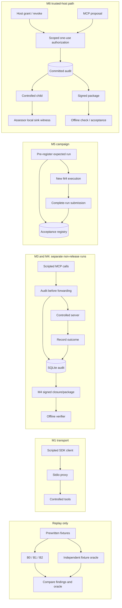

# ChainGuard

ChainGuard is a controlled Model Context Protocol (MCP) security research testbed. It studies how earlier tool calls and permission changes affect a later security decision, and how evidence for that decision can be checked independently. The implementation uses local stdio MCP, deterministic detectors, durable audit records, signed evidence and expected-run acceptance. Demonstrations use scripted requests and synthetic data; the final comparative research study remains incomplete.

## Problem and research question

A proposed tool call can look acceptable in isolation but have a different meaning after a sensitive read, a grant, a revocation or consumption of a one-use permission. ChainGuard compares three views of that history under a fixed policy: **B0** sees the current event, **B1** adds conservative unordered prior facts, and **B2** uses ordered state. B2-R evaluates the full prefix; B2-S updates state incrementally. Their agreement checks implementation consistency, while independent fixture and runtime observations are needed to assess correctness.

The research question is where these representations change authorization errors, warnings and legitimate task outcomes, and what evidence is needed to support those conclusions. Context-aware enforcement and signed logging already exist in prior work. ChainGuard's proposed contribution is a controlled, independently labeled comparison joined to an explicit evidence lifecycle; it does not claim a new cryptographic primitive or priority over earlier session-aware systems. The [charter](docs/PROJECT_CHARTER.md), [architecture lock](docs/ARCHITECTURE_LOCK.md) and [evaluation protocol](docs/EVALUATION_PROTOCOL.md) define the scope.

## System architecture

The milestones share components but are **not one continuous MCP session**. M1 checks transport; M2 replays fixtures without executing tools; M3 and M4 run separate live non-release sessions. M5 pre-registers an expected run and invokes M4 again inside its own campaign. M6 has a separate trusted-host path for scoped synthetic release; M6Q is retained engineering qualification of that path.



The controller, not a detector finding, decides whether to forward. In the M6 path, grants come from the trusted host, never from client metadata. Required proposal, decision and dispatch-intent records are committed before forwarding; the tool outcome is recorded separately. SQLite and external tool effects are not one atomic transaction, so ambiguous outcomes halt rather than trigger automatic replay. The [threat model](docs/THREAT_MODEL.md) states the trust assumptions.

## Implemented milestones

| Stage | What it demonstrates | Main output and boundary |
| --- | --- | --- |
| **M1** | Scripted SDK client → local proxy → controlled `echo`/`controlled_failure` server; success, tool error, then success. | Correlated client JSON. No signed audit pipeline. |
| **M2** | Deterministic replay of authored synthetic journals through B0/B1/B2 with prewritten expectations and an independent fixture oracle. | Per-proposal findings and oracle observations; B2-R/B2-S equivalence on valid prefixes. No live tool or database write. |
| **M3** | Live non-release requests and typed, durable SQLite recording before forwarding. | Transaction receipts, reconstructed history and unsealed closure. |
| **M4** | Separate live non-release run with a SHA-256 event chain and ECDSA P-256/SHA-256 signed clean closure. | Evidence package and separate-process inspection of structure, integrity, signature, context, completeness and reproduced findings. |
| **M5** | Pre-registration, an internally invoked M4 run, whole-run acceptance and a duplicate attempt after process restart. | Durable first `ACCEPTED`, then `REJECTED/ALREADY_ACCEPTED`; synthetic mutation and engineering checks are reported separately. |
| **M6** | Trusted-host scoped grant/revoke, one-use reservation, controlled child and synthetic local sink. | Authorization decisions, audit records, host/child/sink witnesses, signed clean-close evidence and offline checks. |
| **M6Q** | Retained M6 engineering cases, including a separate pre-dispatch persistence fault. | Historical case results, fresh-process reinspection and acceptance readback. It is inspected during the professor run, never rerun by it. |

## What verification establishes

Canonical records and a hash chain support integrity checks against a trusted commitment. A pinned P-256 public key verifies who signed the clean closure. Offline reproduction checks whether stored findings follow the approved detector and policy code. An independently registered inventory and durable registry decide whether a complete run is eligible for a fresh submission. These are separate checks: a valid signature does **not** prove that an observed event happened, that behavior was benign, or that the local timestamp is trusted. `ALREADY_ACCEPTED` rejects evidence duplication; it does not prevent replay of a tool execution. The [claims register](docs/CLAIMS_REGISTER.md) records the permitted claim language.

## Repository guide

```text
ChainGuard/
├── chainguard/                 Runtime, detectors, authorization, audit and verification
├── tests/                      Engineering tests and authored synthetic fixtures
├── scripts/demo/               Professor demonstration runner
├── docs/                       Architecture, methodology, claims, guides and paper
│   └── overleaf-evaluation1/   IEEE source and figure assets
├── results/                    Historical evidence and focused research assessments
├── requirements-m1.txt         Local dependency pins
└── LICENSE                     Root project licence
```

- **Implementation:** [`client.py`](chainguard/client.py), [`proxy.py`](chainguard/proxy.py) and [`controlled_server.py`](chainguard/controlled_server.py) form the M1 path. [`semantics.py`](chainguard/semantics.py), [`detectors.py`](chainguard/detectors.py), [`m2.py`](chainguard/m2.py) and [`oracle.py`](chainguard/oracle.py) support replay and independent labels. [`audit.py`](chainguard/audit.py), [`evidence.py`](chainguard/evidence.py), [`verifier.py`](chainguard/verifier.py) and [`acceptance.py`](chainguard/acceptance.py) implement persistence, signing, inspection and acceptance. [`m6_live_runtime.py`](chainguard/m6_live_runtime.py) and [`m6_live_authorization.py`](chainguard/m6_live_authorization.py) are the live trusted-host entry and permission controller; neighboring `m6_live_*` modules define its profile, audit, evidence, sealing and verifier contracts.
- **Execution and tests:** [`Run-ProfessorDemo.ps1`](scripts/demo/Run-ProfessorDemo.ps1) is the maintained demonstration entry point. [`tests/`](tests/) contains regression and fault checks plus fixture modules used by replay and the M5 campaign. Scripts under [`results/`](results/) are retained qualification or analysis utilities with specific historical inputs and outputs, not general-purpose commands to rerun.
- **Research records:** [`RESULTS_LEDGER.md`](docs/RESULTS_LEDGER.md) and [`CLAIMS_REGISTER.md`](docs/CLAIMS_REGISTER.md) give current evidence and claim status; [`EVALUATION_PROTOCOL.md`](docs/EVALUATION_PROTOCOL.md) and [`EXPERIMENT_MATRIX.md`](docs/EXPERIMENT_MATRIX.md) define the planned study. [`results/`](results/) holds earlier M6Q witnesses, E03/E09/E11 assessments and development artifacts. Fresh professor-run logs and keys are created **outside** the repository, not mixed with those historical records.
- **Preparation and paper:** The [professor output guide](docs/PROFESSOR_DEMO_OUTPUT_GUIDE.md) traces each input to its output and artifact. The [IEEE source](docs/overleaf-evaluation1/main.tex) and [figure assets](docs/overleaf-evaluation1/figures/) are an Evaluation-1 snapshot; the bibliography is inline in `main.tex`.

## Requirements and run

Use PowerShell from the repository root with the existing approved `.venv`. The successful local run used Python 3.14.3. [`requirements-m1.txt`](requirements-m1.txt) records the local pins, including the MCP Python SDK and `cryptography`; SQLite and `unittest` come from Python. The repository does not provide a verified clean-install procedure or guarantee that a public checkout includes `.venv`. M4/M5 use an internal Git revision lookup for configuration identity. Do not install or upgrade dependencies as part of the demonstration.

```powershell
.\scripts\demo\Run-ProfessorDemo.ps1
```

The runner checks the interpreter, imports and required retained M6Q files, then creates a fresh GUID-named folder under `$env:TEMP`. It runs M1–M5 as separate demonstrations, repeats M4 verification in a standalone process, and reads M6Q status without changing historical evidence. Raw stdout/stderr, generated databases, packages and `run-manifest.json` remain in that external folder, including after failure. The manifest records commands, times, exit codes, artifact paths and checks. Keep the folder private: M4 and M5 create unencrypted **synthetic fixture private keys** that must not be published or committed. For individual commands and exact JSON fields, use the [output guide](docs/PROFESSOR_DEMO_OUTPUT_GUIDE.md).

An inspected owner run completed all runner steps, including standalone M4 inspection and M5's expected duplicate rejection. That is a bounded engineering demonstration, not a new research experiment. A fresh run has different IDs, hashes, paths, timestamps and signatures.

## Evaluation and evidence status

For the current presentation sequence and safety checks, use the [operational readiness checklist](docs/FINAL_PROFESSOR_DEMONSTRATION_READINESS.md).

The [evaluation protocol](docs/EVALUATION_PROTOCOL.md) requires independently specified workflow labels and source/sink/task observations, matched representation comparisons, frozen case definitions, workflow-level denominators and explicit unknowns. Engineering tests, replay fixtures and repeated prefixes are not independent research samples. The [results ledger](docs/RESULTS_LEDGER.md) and [claims register](docs/CLAIMS_REGISTER.md) are the status authorities: **no E01–E13 experiment is fully contract-qualified as a research result**.

E03 has a retained pilot but lacks the separate, verifiable task-level client objective acknowledgment required by its contract; its larger proposed cohort is unapproved. E09 has five A3 development cells, with three expected-dimension matches and two preserved schema-first mismatches; seven-variant parity is incomplete. E11 has passing acceptance-lifecycle engineering methods but lacks A3T/A4T research support and an independent case population/oracle. M6Q cases and narrow external-reference conformance support bounded engineering claims only. No held-out superiority, general disclosure-prevention rate or final cost/scaling result follows from them. Focused assessments are under [`results/`](results/); the ledger explains their eligibility.

## Limits and next work

Coverage is a configured local MCP stdio subset with controlled tools and synthetic canaries. It does not establish protection for arbitrary MCP servers or transports, real LLM prompt-injection behavior, full information-flow tracking or trusted time. Coarse historical exposure can warn on benign public transfers. Trust in the host, assessor witnesses, signing key, external expectations and registry is explicit; registry rollback and full host compromise lie outside the demonstrated boundary. Final research work must qualify independent live outcomes, complete the evidence-variant and external comparisons, run held-out workflows, and measure latency, retained state and storage under the frozen protocol.

## Paper, contributors and licence

The [IEEE paper source](docs/overleaf-evaluation1/main.tex) describes an earlier Evaluation-1 engineering snapshot; current implementation and research status should be checked against the ledger. No submission or publication status is claimed. Aryan Malik and Saanvi Bansal are named in the project licence and paper source. Original ChainGuard material is under the root [MIT Licence](LICENSE); third-party packages, external reference material, datasets and paper assets may have separate terms.

## Local frontend — updated 4 November 2026

The React console launches real M1, M4 and M6.4 workflows through a FastAPI adapter. It displays tool responses, actual controller authorization decisions, adapter progress, committed audit records, B0/B1/B2-R/B2-S findings, signed closure, offline inspection and complete-run acceptance where supported. It loads no mock security results.

On 4 November, fetching `origin/main` found 12 new commits. The checkout was fast-forwarded from `3688081` to **65d0eb6cd2a57eaac168fe5b69873639e4cf20bc**. Local frontend changes were backed up and restored; the upstream README and its newer demonstration instructions were retained. The adapter now provisions the new trusted M6 code-revision assertion from local Git HEAD and captures the new host/child witnesses in a fresh external workspace. Browser input cannot choose that revision or witness path. No local changes were made to upstream security-runtime code or dependency pins.

The interface now presents a visible input → context/decision → tool/audit → evidence flow. A guided workflow joins each actual result to its request, grant or revocation. Before execution it shows preset inputs and step descriptions only; there are no predicted output fields. After execution, only recorded responses and committed controls receive observed status. The site includes an expandable walkthrough explaining M1–M6 and which milestones have runnable UI scenarios.

The Python runtime and web adapter use separate environments: the existing MCP pins require Starlette 1.7.0, while the approved FastAPI 0.121.0 requires Starlette below 0.50. This isolation preserves the original runtime dependency set. The adapter launches a fixed worker with `.venv/bin/python`; the worker uses the upstream demo functions and public M6 host/MCP ingress. It does not bypass or rewrite the security controller.

### First-time installation on macOS

Use Python 3.14 and a Node version supported by Vite 7 (Node 20.19+ or 22.12+). This implementation was checked with Python 3.14.3, Node 25.2.1 and npm 11.6.2. All commands below run inside the project; nothing needs a global package installation.

In Terminal, install the existing runtime:

```zsh
cd ~/Desktop/fin_chain/ChainGuard
python3 -m venv .venv
.venv/bin/python -m pip install -r requirements-runtime-macos.txt
```

This file preserves every version from `requirements-m1.txt`, with Windows-only `pywin32` qualified by platform. Then install the adapter into its own environment:

```zsh
cd ~/Desktop/fin_chain/ChainGuard
python3 -m venv .venv-web
.venv-web/bin/python -m pip install -r requirements-web.lock.txt
```

`requirements-web.txt` lists the approved direct dependencies; `requirements-web.lock.txt` records the full installed set. Install the frontend:

```zsh
cd ~/Desktop/fin_chain/ChainGuard/frontend
npm ci
```

### Start the application

Terminal 1 — backend, from the repository root:

```zsh
cd ~/Desktop/fin_chain/ChainGuard
.venv-web/bin/python -m uvicorn frontend_api.api:app --host 127.0.0.1 --port 8001
```

Terminal 2 — frontend:

```zsh
cd ~/Desktop/fin_chain/ChainGuard/frontend
npm run dev
```

Open **http://127.0.0.1:5174/** in your browser. These ports avoid other applications already using 8000 and 5173 on the development machine. Use one backend worker. Stop either server with **Control-C** in its Terminal.

Select **Live authorization & acceptance · M6.4**, inspect the read-only preset inputs, then click **Run demonstration**. This fresh synthetic scenario exercises source access, scoped grants, one-use consumption, revocation, regrant and a deliberate tool failure. The page does not display an output prediction before execution.

Use **Step-by-step workflow** to read inputs alongside actual results and controller decisions. **Tool outputs** shows returned content and errors; **Detectors** shows recorded shadow findings; **Permissions** shows real dispatch decisions and committed host controls; **Evidence** separates inspection and acceptance; **Execution observations** shows host/server witnesses separately from signed audit; **Raw JSON** shows the full report. **Signed evidence · M4** remains the non-release signed-inspection demo, while **MCP mediation · M1** remains transport-only. **Clear result** resets the view without replaying tools. Selecting another scenario clears the selected result so data from two demos are not mixed.

### Site walkthrough and milestone meanings

The expandable **Site walkthrough · M1–M6 explained** guide is above the controls. Choose a demo, inspect its preset inputs, run it, follow the observed steps and then explore the detailed tabs. The four-stage diagram explains the path; the legend distinguishes returned tool content, controller denial and tool execution error. Signature/inspection and complete-run acceptance are separate from behavioral findings.

| Milestone | What it demonstrates | UI availability |
| --- | --- | --- |
| M2 | Replay current-event B0, conservative unordered B1 and ordered B2-R/B2-S on prewritten histories; independent fixture oracle and reference/streaming consistency. No live tool execution. | Explained in the walkthrough; standalone replay remains CLI-only. |
| M3 | Real non-release calls with durable SQLite proposal/decision/intent persistence before dispatch, followed by recorded outcomes. No signed closure. | Explained in the walkthrough; standalone M3 remains CLI-only. |
| M4 | Hash-chained audit, ECDSA P-256 signed closure and six-dimensional offline inspection. Inspection does not accept a fresh submission. | Signed evidence scenario. |
| M5 | Pre-execution registered inventory/configuration/signer, complete-run submission and durable duplicate rejection. | M6.4 uses this acceptance registry; the full standalone M5 campaign remains CLI-only. |
| M6 | Trusted host scoped grant/revoke/one-use authority on real mediated synthetic calls; M6.4 adds signed export, inspection and submission. | Live authorization & acceptance scenario. |

These are capabilities demonstrated by separate runs, not one continuous M1–M6 conversation. This frontend never reruns or overwrites the historical M6Q qualification tree under `results/`.

### How the frontend works

1. React loads the supported scenarios from `GET /api/scenarios`. Their descriptions, preset input arguments and workflow structure come from the local adapter; no predicted output fields are included.
2. Clicking **Run demonstration** sends only the selected scenario ID to `POST /api/runs`. Browser input cannot supply commands, grants, destinations or tool arguments.
3. FastAPI creates a run ID and launches a fixed worker using the existing runtime interpreter. The host supplies the current checkout revision through `CHAINGUARD_TRUSTED_CODE_REVISION`; the browser cannot supply it. M1/M4 use their original demo functions. M6 uses public `M6Host` and `HostTask.serve_client` interfaces; MCP frames and trusted host controls enter the existing serialized mediation path. Its new `witness_dir` is inside the fresh external temporary directory.
4. The UI polls run status every second during execution. Adapter progress is available immediately; real audit records and results arrive after the workflow finishes.
5. The UI renders the returned data. ChainGuard's Python code performs authorization, detection, audit persistence, signing, inspection and acceptance. React does not make security decisions.

The key files are [`App.jsx`](frontend/src/App.jsx) for selection and polling, [`WorkflowView.jsx`](frontend/src/components/WorkflowView.jsx) for input/result linkage, [`Walkthrough.jsx`](frontend/src/components/Walkthrough.jsx) for site and milestone explanations, [`RunResults.jsx`](frontend/src/components/RunResults.jsx) for result panels, [`model.js`](frontend/src/model.js) for correlation/classification, [`api.py`](frontend_api/api.py) for HTTP/run management, [`runtime_context.py`](frontend_api/runtime_context.py) for host-owned revision provisioning, [`scenario_guides.py`](frontend_api/scenario_guides.py) for preset inputs, and [`live_demo.py`](frontend_api/live_demo.py) for the fixed M6 workflow.

### API and behavior

| Endpoint | Behavior |
| --- | --- |
| `GET /api/health` | Adapter status, current revision, runtime configuration readiness and busy state |
| `GET /api/scenarios` | Allowlisted fixed demonstrations and supported capabilities |
| `POST /api/runs` | JSON with `scenario_id`: `live-authorization`, `signed-evidence`, or `mediation`; returns 202 |
| `GET /api/runs/{run_id}` | Run status, real report, exit code and sanitized errors |
| `GET /api/runs/{run_id}/events` | Adapter events and completed M4/M6 audit records; JSON polling |
| `GET /api/runs/{run_id}/evidence` | Public package, actual offline inspection and explicit acceptance status |

The frontend proxies `/api` to port 8001. POST requests require `Content-Type: application/json` and `X-ChainGuard-Client: local-dashboard`; the browser origin and host are checked. This is a local development boundary, not user authentication or a public deployment design. Both servers bind to loopback.

Runs execute sequentially; a second active run returns 409. Each worker has a 150-second timeout and an external temporary workspace. Completion, failure, timeout and adapter shutdown clean up temporary evidence and signing keys. Public reports are retained in memory for the latest 20 runs and disappear when the backend restarts. No private keys are returned. Error details in the API do not include raw process stderr; use the documented CLI for local diagnostics.

For M6, the worker creates assessor expectations and a P-256 signer in memory before opening the live task. Expected inventory, configuration and public-key pin are registered and read back durably before task execution. After clean shutdown, the actual runtime exports and inspects the package; the existing acceptance registry then accepts the complete run. Reopening the registry and submitting the same package demonstrates duplicate rejection. The private key is never serialized. The registry is a temporary demonstration fixture and is removed after the run; this frontend does not provide a persistent cross-run submission service.

M6 host/child witness streams are separate local observations, not signed audit and not proof against a dishonest host. The web report omits raw frame and payload copies. This scenario uses the controlled server's local sink observations; no external assessor TCP sink is configured. Witness files are cleaned up with the temporary workspace.

### Verification and current limits

```zsh
cd ~/Desktop/fin_chain/ChainGuard
CHAINGUARD_TRUSTED_CODE_REVISION="$(git rev-parse HEAD)" .venv/bin/python -B -m unittest discover -s tests -v
.venv-web/bin/python -B -m unittest discover -s frontend_api/tests -v
cd frontend
npm test
npm run build
```

Actual checks on 4 November 2026: **471 upstream tests passed in 168.064s**, **18 adapter tests passed**, **16 frontend data/rendering tests passed**, and the production build passed. The first sandboxed upstream run had one permission error because a new test binds a localhost socket; the complete suite passed when rerun with that permission. Adapter tests verify actual M1/M4/M6 execution, guide-to-request identity, exact revision provisioning, witness capture/sanitization, control injection rejection, registration-readback gating, acceptance and duplicate rejection. Frontend tests verify typed request correlation, exact grant/revocation scope, absence of predicted output and honest missing-result presentation. A real M6 run through the frontend proxy completed with 59 audit records, 28 findings, seven PASS inspection dimensions, ACCEPTED submission and ALREADY_ACCEPTED on resubmission, plus 53 host and 8 child observations. Browser interaction, visual layout and responsive behavior remain unverified in a real browser in this session.

Custom arguments, interactive grant/revoke controls, live streaming of internal runtime events and a retained evidence-submission service remain follow-up work. The detector panel shows actual recorded findings and references; it does not yet display each evaluator's historical input representation. Adapter progress uses polling; audit records appear only after the demo completes. M1 exposes no policy evaluation or signed evidence. M4's public non-release history and the fixed M6 scenario do not establish detector superiority or final workflow qualification.

M4 performs inspection, so fresh submission is **NOT_CHECKED**. M6 inspection also retains **NOT_CHECKED** for that operation, while its separate registry submission reports actual **ACCEPTED** or rejection status. Signatures authenticate commitments and do not prove that observations are true or actions are safe. Evidence acceptance likewise does not certify benign behavior.

The owner chose to retain **Vite 7.2.2** after `npm audit` reported advisories and identified 7.3.7 as a compatible fix. The current audit reports one high-severity affected dependency. No automatic dependency upgrade was applied.

If the dashboard says **Backend offline**, check Terminal 1 and port 8001. If it says **Runtime unavailable**, complete the runtime installation and restart the backend; readiness is cached. If a previous run expires or the backend restarts, the dashboard clears the stale run and allows another demonstration. If a port is occupied, do not stop an unrelated process; choose a free port and update the frontend proxy, browser-origin allowlist and startup commands consistently. A `.zshenv` warning about a missing Java installation comes from the user's shell configuration; this Python/React project does not require Java.

Frontend source is under `frontend/` (React/Vite console and tests) and `frontend_api/` (adapter, fixed worker and tests), with the three dependency files above. Local Python environments, installed Node packages, build output and generated evidence are excluded from version control.
