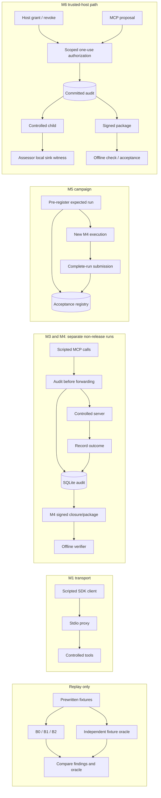

# ChainGuard

ChainGuard is a controlled Model Context Protocol (MCP) security research testbed. It studies how earlier tool calls and permission changes affect a later security decision, and how evidence for that decision can be checked independently. The implementation uses local stdio MCP, deterministic detectors, durable audit records, signed evidence and expected-run acceptance. Demonstrations use scripted requests and synthetic data; the final comparative research study remains incomplete.

## Problem and research question

A proposed tool call can look acceptable in isolation but have a different meaning after a sensitive read, a grant, a revocation or consumption of a one-use permission. ChainGuard compares three views of that history under a fixed policy: **B0** sees the current event, **B1** adds conservative unordered prior facts, and **B2** uses ordered state. B2-R evaluates the full prefix; B2-S updates state incrementally. Their agreement checks implementation consistency, while independent fixture and runtime observations are needed to assess correctness.

The research question is where these representations change authorization errors, warnings and legitimate task outcomes, and what evidence is needed to support those conclusions. Context-aware enforcement and signed logging already exist in prior work. ChainGuard's proposed contribution is a controlled, independently labeled comparison joined to an explicit evidence lifecycle; it does not claim a new cryptographic primitive or priority over earlier session-aware systems. The [charter](docs/PROJECT_CHARTER.md), [architecture lock](docs/ARCHITECTURE_LOCK.md) and [evaluation protocol](docs/EVALUATION_PROTOCOL.md) define the scope.

## System architecture

The milestones share components but are **not one continuous MCP session**. M1 checks transport; M2 replays fixtures without executing tools; M3 and M4 run separate live non-release sessions. M5 pre-registers an expected run and invokes M4 again inside its own campaign. M6 has a separate trusted-host path for scoped synthetic release; M6Q is retained engineering qualification of that path.



The controller, not a detector finding, decides whether to forward. In the M6 path, grants come from the trusted host, never from client metadata. Required proposal, decision and dispatch-intent records are committed before forwarding; the tool outcome is recorded separately. SQLite and external tool effects are not one atomic transaction, so ambiguous outcomes halt rather than trigger automatic replay. The [threat model](docs/THREAT_MODEL.md) states the trust assumptions.

## Implemented milestones

| Stage | What it demonstrates | Main output and boundary |
| --- | --- | --- |
| **M1** | Scripted SDK client → local proxy → controlled `echo`/`controlled_failure` server; success, tool error, then success. | Correlated client JSON. No signed audit pipeline. |
| **M2** | Deterministic replay of authored synthetic journals through B0/B1/B2 with prewritten expectations and an independent fixture oracle. | Per-proposal findings and oracle observations; B2-R/B2-S equivalence on valid prefixes. No live tool or database write. |
| **M3** | Live non-release requests and typed, durable SQLite recording before forwarding. | Transaction receipts, reconstructed history and unsealed closure. |
| **M4** | Separate live non-release run with a SHA-256 event chain and ECDSA P-256/SHA-256 signed clean closure. | Evidence package and separate-process inspection of structure, integrity, signature, context, completeness and reproduced findings. |
| **M5** | Pre-registration, an internally invoked M4 run, whole-run acceptance and a duplicate attempt after process restart. | Durable first `ACCEPTED`, then `REJECTED/ALREADY_ACCEPTED`; synthetic mutation and engineering checks are reported separately. |
| **M6** | Trusted-host scoped grant/revoke, one-use reservation, controlled child and synthetic local sink. | Authorization decisions, audit records, host/child/sink witnesses, signed clean-close evidence and offline checks. |
| **M6Q** | Retained M6 engineering cases, including a separate pre-dispatch persistence fault. | Historical case results, fresh-process reinspection and acceptance readback. It is inspected during the professor run, never rerun by it. |

## What verification establishes

Canonical records and a hash chain support integrity checks against a trusted commitment. A pinned P-256 public key verifies who signed the clean closure. Offline reproduction checks whether stored findings follow the approved detector and policy code. An independently registered inventory and durable registry decide whether a complete run is eligible for a fresh submission. These are separate checks: a valid signature does **not** prove that an observed event happened, that behavior was benign, or that the local timestamp is trusted. `ALREADY_ACCEPTED` rejects evidence duplication; it does not prevent replay of a tool execution. The [claims register](docs/CLAIMS_REGISTER.md) records the permitted claim language.

## Repository guide

```text
ChainGuard/
├── chainguard/                 Runtime, detectors, authorization, audit and verification
├── tests/                      Engineering tests and authored synthetic fixtures
├── scripts/demo/               Professor demonstration runner
├── docs/                       Architecture, methodology, claims, guides and paper
│   └── overleaf-evaluation1/   IEEE source and figure assets
├── results/                    Historical evidence and focused research assessments
├── requirements-m1.txt         Local dependency pins
└── LICENSE                     Root project licence
```

- **Implementation:** [`client.py`](chainguard/client.py), [`proxy.py`](chainguard/proxy.py) and [`controlled_server.py`](chainguard/controlled_server.py) form the M1 path. [`semantics.py`](chainguard/semantics.py), [`detectors.py`](chainguard/detectors.py), [`m2.py`](chainguard/m2.py) and [`oracle.py`](chainguard/oracle.py) support replay and independent labels. [`audit.py`](chainguard/audit.py), [`evidence.py`](chainguard/evidence.py), [`verifier.py`](chainguard/verifier.py) and [`acceptance.py`](chainguard/acceptance.py) implement persistence, signing, inspection and acceptance. [`m6_live_runtime.py`](chainguard/m6_live_runtime.py) and [`m6_live_authorization.py`](chainguard/m6_live_authorization.py) are the live trusted-host entry and permission controller; neighboring `m6_live_*` modules define its profile, audit, evidence, sealing and verifier contracts.
- **Execution and tests:** [`Run-ProfessorDemo.ps1`](scripts/demo/Run-ProfessorDemo.ps1) is the maintained demonstration entry point. [`tests/`](tests/) contains regression and fault checks plus fixture modules used by replay and the M5 campaign. Scripts under [`results/`](results/) are retained qualification or analysis utilities with specific historical inputs and outputs, not general-purpose commands to rerun.
- **Research records:** [`RESULTS_LEDGER.md`](docs/RESULTS_LEDGER.md) and [`CLAIMS_REGISTER.md`](docs/CLAIMS_REGISTER.md) give current evidence and claim status; [`EVALUATION_PROTOCOL.md`](docs/EVALUATION_PROTOCOL.md) and [`EXPERIMENT_MATRIX.md`](docs/EXPERIMENT_MATRIX.md) define the planned study. [`results/`](results/) holds earlier M6Q witnesses, E03/E09/E11 assessments and development artifacts. Fresh professor-run logs and keys are created **outside** the repository, not mixed with those historical records.
- **Preparation and paper:** The [professor output guide](docs/PROFESSOR_DEMO_OUTPUT_GUIDE.md) traces each input to its output and artifact. The [IEEE source](docs/overleaf-evaluation1/main.tex) and [figure assets](docs/overleaf-evaluation1/figures/) are an Evaluation-1 snapshot; the bibliography is inline in `main.tex`.

## Requirements and run

Use PowerShell from the repository root with the existing approved `.venv`. The successful local run used Python 3.14.3. [`requirements-m1.txt`](requirements-m1.txt) records the local pins, including the MCP Python SDK and `cryptography`; SQLite and `unittest` come from Python. The repository does not provide a verified clean-install procedure or guarantee that a public checkout includes `.venv`. M4/M5 use an internal Git revision lookup for configuration identity. Do not install or upgrade dependencies as part of the demonstration.

```powershell
.\scripts\demo\Run-ProfessorDemo.ps1
```

The runner checks the interpreter, imports and required retained M6Q files, then creates a fresh GUID-named folder under `$env:TEMP`. It runs M1–M5 as separate demonstrations, repeats M4 verification in a standalone process, and reads M6Q status without changing historical evidence. Raw stdout/stderr, generated databases, packages and `run-manifest.json` remain in that external folder, including after failure. The manifest records commands, times, exit codes, artifact paths and checks. Keep the folder private: M4 and M5 create unencrypted **synthetic fixture private keys** that must not be published or committed. For individual commands and exact JSON fields, use the [output guide](docs/PROFESSOR_DEMO_OUTPUT_GUIDE.md).

An inspected owner run completed all runner steps, including standalone M4 inspection and M5's expected duplicate rejection. That is a bounded engineering demonstration, not a new research experiment. A fresh run has different IDs, hashes, paths, timestamps and signatures.

## Evaluation and evidence status

The [evaluation protocol](docs/EVALUATION_PROTOCOL.md) requires independently specified workflow labels and source/sink/task observations, matched representation comparisons, frozen case definitions, workflow-level denominators and explicit unknowns. Engineering tests, replay fixtures and repeated prefixes are not independent research samples. The [results ledger](docs/RESULTS_LEDGER.md) and [claims register](docs/CLAIMS_REGISTER.md) are the status authorities: **no E01–E13 experiment is fully contract-qualified as a research result**.

E03 has a retained pilot but lacks the separate, verifiable task-level client objective acknowledgment required by its contract; its larger proposed cohort is unapproved. E09 has five A3 development cells, with three expected-dimension matches and two preserved schema-first mismatches; seven-variant parity is incomplete. E11 has passing acceptance-lifecycle engineering methods but lacks A3T/A4T research support and an independent case population/oracle. M6Q cases and narrow external-reference conformance support bounded engineering claims only. No held-out superiority, general disclosure-prevention rate or final cost/scaling result follows from them. Focused assessments are under [`results/`](results/); the ledger explains their eligibility.

## Limits and next work

Coverage is a configured local MCP stdio subset with controlled tools and synthetic canaries. It does not establish protection for arbitrary MCP servers or transports, real LLM prompt-injection behavior, full information-flow tracking or trusted time. Coarse historical exposure can warn on benign public transfers. Trust in the host, assessor witnesses, signing key, external expectations and registry is explicit; registry rollback and full host compromise lie outside the demonstrated boundary. Final research work must qualify independent live outcomes, complete the evidence-variant and external comparisons, run held-out workflows, and measure latency, retained state and storage under the frozen protocol.

## Paper, contributors and licence

The [IEEE paper source](docs/overleaf-evaluation1/main.tex) describes an earlier Evaluation-1 engineering snapshot; current implementation and research status should be checked against the ledger. No submission or publication status is claimed. Aryan Malik and Saanvi Bansal are named in the project licence and paper source. Original ChainGuard material is under the root [MIT Licence](LICENSE); third-party packages, external reference material, datasets and paper assets may have separate terms.
